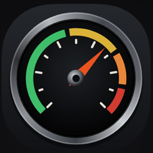
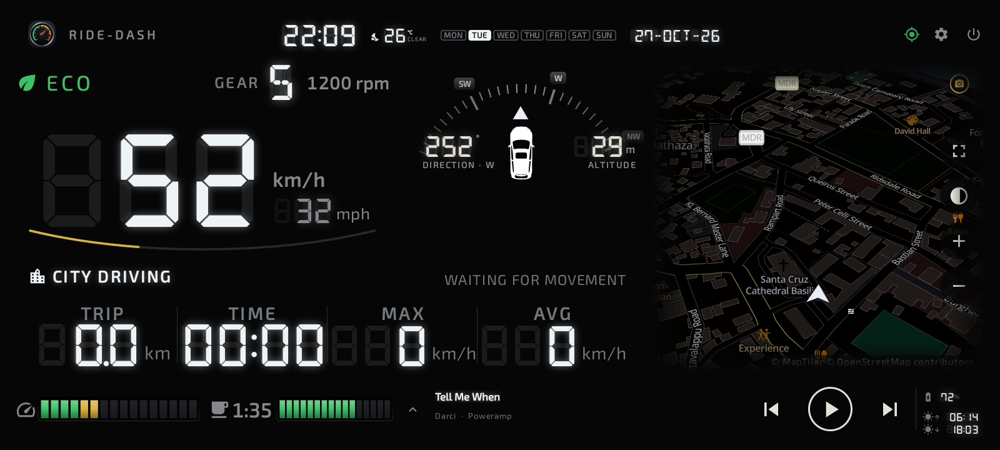

## Your ride companion

Ride-Dash turns the phone in your holder into a full car dashboard: live speed, trip statistics, nearby sights,
one-touch navigation and a break reminder — for the driver and everyone riding along.

**Free during the beta.** Everyone who installs Ride-Dash during the beta keeps it free, for good.

- **See the ride:** speed, gear, rpm, heading, altitude and driving style, live.
- **Know the trip:** distance, moving time, top and average speed, saved for every drive and exported to Excel.
- **Find places:** viewpoints and sights marked on the map; long-press any place to navigate there with Google Maps.
- **Stay fresh:** a gentle reminder when it's time for a break.
- **Make it yours:** 8 dashboard layouts and 7 colour schemes.

Ride-Dash runs on Android phones (Android 8 or newer) and also as the home screen of Android car head units.

## Learn more

- [User guide](user-guide.html)
- [Privacy policy](privacy-policy.html)

## Feedback and feature requests

Ride-Dash is in beta and your ideas shape it. Send feedback, report a problem or ask for a feature:
**[ridedash.app@gmail.com](mailto:ridedash.app@gmail.com)**
