# Ride-Dash user manual

_Version 1.11.1 · November 2026_

Ride-Dash turns the phone in your holder — or your car's Android head unit — into a calm, complete car dashboard:
live speed, gear, heading and altitude, the road you are on and its speed limit, trip statistics, terrain, speed
breaker and break alerts spoken aloud, music, the map with the places you choose, and "Where's my car". Everything
works on the device; no account needed.

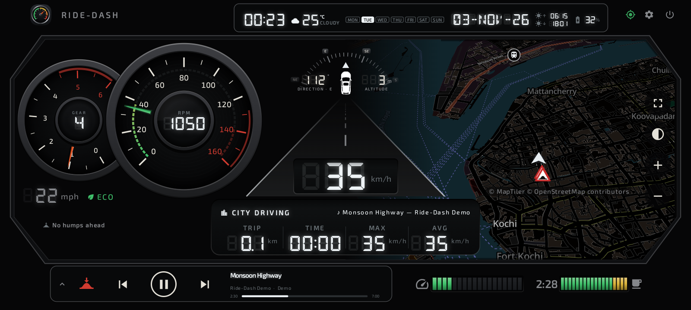

**Contents:** [What's new](#whats-new-in-1120) · [1 Installing](#1-installing) · [2 First start](#2-first-start) ·
[3 The dashboard](#3-the-dashboard) · [4 Layouts and colours](#4-layouts-and-colours) · [5 Speed and speed limits](#5-speed-and-speed-limits) ·
[6 Driving mode, terrain and road info](#6-driving-mode-terrain-and-road-info) · [7 Map](#7-map) ·
[8 Places on the map](#8-places-on-the-map) · [9 Music](#9-music) · [10 Trips](#10-trips) ·
[11 Breaks](#11-break-reminder) · [12 Speed breakers](#12-speed-breakers) · [13 Voice alerts](#13-voice-alerts) ·
[14 Where's my car](#14-wheres-my-car) · [15 Settings](#15-settings-reference) ·
[16 Export and storage](#16-export-storage-and-deleting-data) · [17 Troubleshooting](#17-troubleshooting)

## What's new in 1.12.0

- **Describe your vehicle:** fuel, gearbox (manual, AMT, automatic, DCT, CVT, EV), engine size and tyres in *Settings ›
  Vehicle* make the estimated gear and rpm much closer to a real car's; calibrate the rpm with one reading from your own
  dashboard. Save several vehicles; trips remember which one you drove, and insights can show one vehicle (section 3).
- **Witty voice alerts:** choose *Alert style › Witty* for light-hearted alerts that still say the important part first
  (section 13).
- **Units in every voice alert:** "fifty miles per hour", "four hundred feet" — and the speed-breaker alert now says how far
  away it is.

## What's new in 1.11.0

- **Backup and restore:** keep your trips, parking history, marked speed breakers and settings in one file, and restore
  them on another phone or head unit (section 16).
- **App updates inside the app** for copies installed from Google Play: *Settings › About › App updates*. Ride-Dash only
  asks while the car stands.

## What's new in 1.10.1

- **Units follow your region:** mph and feet in the US, the UK and other mph countries, km/h and metres elsewhere. Choose
  yourself in *Settings › Trip & speed › Unit* (section 5). The temperature follows your region too.
- **Trip table:** the units are in the column headings, so long speeds are no longer cut off.

## What's new in 1.10.0

- **Driving insights go deeper:** tap any card or chart to see the matching trips, sort them by any column, and open a trip
  for its route on the map, speed over the trip and all its numbers (section 10).
- **New look for the charts:** translucent, with rounded bars and glass cards, in every colour scheme.
- **Larger clock text:** the date in Classic, Sport and Twin is as large as the temperature, and the time in Duo fills its
  display.
- **Map credit:** on the map's edge in Duo, and easier to read in Lap and Open.

## What's new in 1.9.1

- **Driving insights:** tap the new **chart icon** at the top right while parked to see your distance, driving time, a
  driving score, charts and tips for this week, this month or any period (section 10).
- **Street name and next turn together:** during a route the road you are on stays on screen with the next turn, in every
  layout (section 6).
- **Voice alerts** say numbers properly: "three hundred metres", "one point five kilometres" (section 13).
- **Classic and Classic Light:** larger street name and speed-breaker status, with the next turn on the other side of the
  compass.

## What's new in 1.9.0

- **Street names everywhere:** the road you are on now updates on every layout and on older head units too; Classic
  and Twin show it on small screens as well, and an old name no longer stays on screen after you have moved on
  (section 6).
- **Navigation:** the route is a pale blue line with a thin grey edge, the part already driven grey; starting a route
  brings the map back to your car. The next-turn card over the map has no black box any more (section 7).
- **Routing limit:** when the shared routing key's daily limit is used up, Ride-Dash explains how to get a free key of
  your own; **Test key** in *Settings › Map › Navigation* checks it (section 7).
- **Look:** speed and trip digits are a little bolder; GPS, Settings and Power line up with the frame on the right.

## What's new in 1.8.0

- **Navigation on the Ride-Dash map:** long-press a place, tap a place icon or search one, then **Navigate** — the
  route is drawn on Ride-Dash's own map, the dashboard shows the next turn with its arrow, the distance to it and your
  arrival time, and the turns are spoken. Leave the route and a new one is worked out. **Google Maps** is still one tap
  away in the same question (section 7).
- **Search a place:** the new **🔍 button** on the map finds places and addresses by name, nearby ones first
  (section 7).
- **Your own routing key** (optional): *Settings › Map › Navigation*.
- **Voice:** a new *Turns* switch in *Settings › Trip & speed › Voice alerts*.
- **Light layouts:** place names on the map are crisp again, and the light layouts are listed first in
  *Settings › Appearance*.

## What's new in 1.7.0

- **Light layouts** for bright daylight: **Classic Light**, **Twin Light**, **Duo Light** and **Sport Light** — a light
  background, silver frame, light dials and displays and a light map, in every colour scheme. They have their own
  *Light layouts* section in *Settings › Appearance*; the first one you choose starts in White (section 4).
- **Street names on older head units:** the road you are on now shows on the simpler map of older car head units too
  (section 6).
- **Bigger buttons:** Settings, GPS and Power at the top right are larger and easier to tap.
- **Classic:** the speed-breaker status now follows the mph reading at the bottom left.

## What's new in 1.6.0

- **Background colour:** *Settings › Appearance › Background* — from black to mid grey, neutral or with a soft Blue,
  Green, Red, Brown or Purple tint. The dials and displays stay dark and the map takes the same colour (section 4).
- **Places on older head units:** fuel stations, ATMs, hospitals and the other places you ticked now show on the map of
  older car head units too (section 8).
- **Duo reworked:** dials at the top, the speed on the road in a small display, a larger trip display under it, all
  centred; the street name, terrain and next speed breaker (or turn-by-turn) at the bottom left.
- **Classic:** the speed on the road in the same small display.
- **Turn-by-turn:** the next turn's arrow and distance, then the remaining distance and arrival time, larger.
- **Every bar fills left to right**, and Twin's mph is larger.
- **Faster:** smoother dials, and the map appears straight away when Ride-Dash starts.

## What's new in 1.5.0

- **Road speed limits:** a speed-limit sign for the road you are on (from OpenStreetMap, where mapped), and
  "Slow down" at that limit plus a tolerance you choose (section 5).
- **Street name and road info:** the road you are on, the terrain with its gradient ("UPHILL 6 %") and the next speed
  breaker, shown where turn-by-turn normally appears (section 6).
- **Places of your choice on the map:** fuel, EV charging, ATMs, hospitals, toll booths, hotels, viewpoints, places of
  worship and more — tick the ones you want, each with its own icon (section 8).
- **Navigate to a long-pressed place** by name, also on older head units (section 7).
- **Turn-by-turn without a box:** the next turn sits right on the dashboard in every layout.
- **Start-up sweep:** the dials light up and sweep their needles once when Ride-Dash starts (tap to skip).
- **Every layout tidied up:** bigger maps that reach the frame, the driving style as an icon and coloured word, the
  rest bar with the coffee cup after it, rpm in the dial, cleaner info bars.
- White is now the default colour scheme for new installs.

## What's new in 1.3.0

- **Speed breaker alerts:** "Humps ahead · 150 m" before speed breakers on the road ahead, from OpenStreetMap and your
  own marks. One tap on the hump button marks a new one.
- **Voice alerts:** break reminder, "Slow down" and "Speed breaker ahead" spoken through the car speakers; music gets
  quieter meanwhile.
- **Terrain:** FLAT, UPHILL, DOWNHILL, WINDING or GHAT while you drive, and the share of each in the trip log.
- **Where's my car:** your parking spot is saved when a trip ends; walking directions back to it.
- **Waiting for GPS:** the dashboard shows `--` and the satellites found instead of looking frozen; the map starts at
  your last position; GPS starts sooner on head units.
- **Gauges wake up at once** when you drive off after a long stop.
- **Demo mode** for trying everything at your desk (Settings › About, tap the version 7 times).

## 1. Installing

**Phone (Google Play):** search for **Ride-Dash** in Google Play and tap **Install**. Android 8 or newer.

**Car head unit (APK file):** most Android head units can't reach Google Play, so Ride-Dash is installed from a file.

1. Copy `Ride-Dash-<version>-release.apk` to a USB stick (FAT32 or exFAT) and plug it into the unit.
2. Allow installing apps from the file manager: *Settings › Security › Unknown sources* on older units, or
   *Settings › Apps › Special access › Install unknown apps › (file manager) › Allow*. Some units hide this behind a
   factory code — see the unit's manual.
3. Open the file manager, tap the APK, choose **Install**.
4. "App not installed": free about 100 MB of storage and try again; check the unit runs Android 8 or newer
   (*Settings › About*).

Updates install the same way over the old version; your settings and trips are kept.

## 2. First start

1. **Location** — tap **Continue** and allow location "While using the app". Speed, trips, the compass and the map all
   come from GPS.
2. **Notifications** — allow them: the trip keeps counting while other apps are in front.
3. **Music and navigation info (optional)** — *Settings › Launcher & apps › Music controls & track info › Allow* lets
   Ride-Dash show the song and the next turn from Google Maps or Waze.
4. **Head units:** *Settings › Launcher & apps › Set as default home app* (Ride-Dash opens with the car), and
   *Start on boot*.

**Waiting for the first GPS fix.** Until GPS knows where you are, the speed shows `--` and the trip display reads
`SEARCHING GPS · 3/11 SATS` (satellites used / in view). A phone usually needs seconds; a head unit can need a few
minutes the first time, especially indoors.

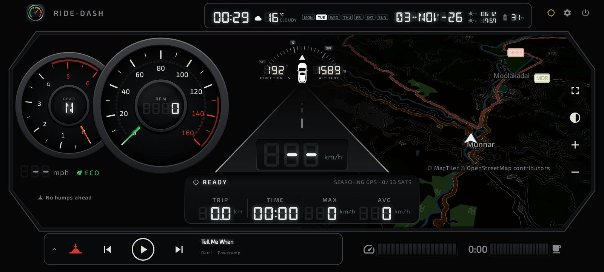

Head-unit tips: the GPS antenna (a small square puck on a cable) must see the sky — put it under the windscreen or the
dashboard top, not inside the glovebox or under metal. Wait outdoors with the engine running the first time. *Settings
› About* shows how long the first fix took.

## 3. The dashboard

| Where | What |
| --- | --- |
| Top left | Your logo and vehicle name; alerts appear here (break, speed breakers) |
| Top centre | Time, weather, sunrise / sunset, battery, weekday and date |
| Top right | Driving insights, GPS status, settings, power (end trip and exit) |
| Driving style | ECO · CITY · IDLE · SPORT — an icon and a coloured word |
| Speedometer | Speed with colour zones; gear and rpm (estimated); the other unit nearby |
| Compass and road | Heading, direction, altitude above sea level; the road animation moves with your speed |
| Road info | Street name, terrain with gradient, next speed breaker — or the next turn while navigating |
| Trip display | Drive mode, terrain, distance, moving time, top and average speed |
| Map | Where you are, heading up; the places you chose, speed breakers, your parked car; speed-limit sign |
| Bottom left | **Hump button** (mark a speed breaker), music controls and track |
| Bottom right | Speed bar and break (rest) bar — driving time, bar, coffee cup |

The arrangement differs per layout, but every layout has the same pieces.

### Gear and rpm are estimated

Ride-Dash has no connection to the engine. **RPM and gear are simulated from GPS speed and acceleration, assuming ideal
conditions. They are not read from the vehicle and may differ from your actual dashboard. Use them as an indication
only, not for driving decisions.**

Describe your vehicle in *Settings › Vehicle › Engine & gearbox*: fuel (petrol, diesel, CNG, hybrid, EV), transmission
(4–6-speed manual or iMT, 5/6-speed AMT, 5–7-speed automatic, 6/7-speed DCT, CVT; an EV gets its single-speed reduction by
itself), engine capacity and turbo or not, tyre size, idle and redline (filled in from the fuel and engine; you can change
them). *Advanced* has the gear ratios and final drive — typical values for the gearbox, or the real ones from your
vehicle's spec sheet — and **RPM calibration**: drive steadily in top gear, enter the speed and the rpm your dashboard
shows, and Ride-Dash corrects for tyre wear and a different final drive. You can save several vehicles (*Add vehicle*,
give each a name); every trip records the vehicle in use, and *Driving insights* can show one vehicle at a time.

How it is worked out: engine rpm = wheel turns per minute (speed ÷ the tyre's rolling circumference) × gear ratio × final
drive × calibration. The gear is chosen like a typical driver: diesels shift earlier than petrol engines, small engines
later, harder acceleration and climbs hold a gear longer, downhill allows a higher one; a gear is held at least 2 seconds.
Automatics show D3 and D when standing, with some torque-converter slip at low speed; a CVT keeps the rpm in a band; an EV
shows the motor rpm (0 when stopped); a hybrid shows **EV** at low speed with light throttle.

Why it can differ from your dashboard:

- GPS speed lags and wobbles, especially at low speed, in tunnels and under trees.
- Your actual gear choice and clutch / throttle use are unknown.
- Tyre wear, tyre pressure and load change the rolling radius by 2–3 %.
- Wheel slip, gradient, load and how your gearbox really shifts (torque-converter slip, AMT / DCT logic) vary by vehicle.
- Typical gear ratios differ from your vehicle's unless you enter them from the spec sheet.

Real rpm and gear would need an OBD-II adapter — possibly a future feature.

## 4. Layouts and colours

*Settings › Appearance.* Pick a **layout** (the arrangement) and a **colour scheme** (the colours) separately.

| Layout | The look |
| --- | --- |
| Open | Frameless: a huge digital speed and big trip readings |
| Lap | Racing visor, speed inside the rpm arc |
| Duo | GT cluster with a wide map |
| Cockpit | One ring gauge in the middle |
| Classic | Analogue speedometer, compass and road |
| Classic Light | Classic on a light background, for bright daylight |
| Twin Light, Duo Light, Sport Light | Twin, Duo and Sport on a light background |
| Sport | Big centred speedometer |
| Modern | Fully digital cluster |
| Twin | Speedometer and rev counter with a map window |

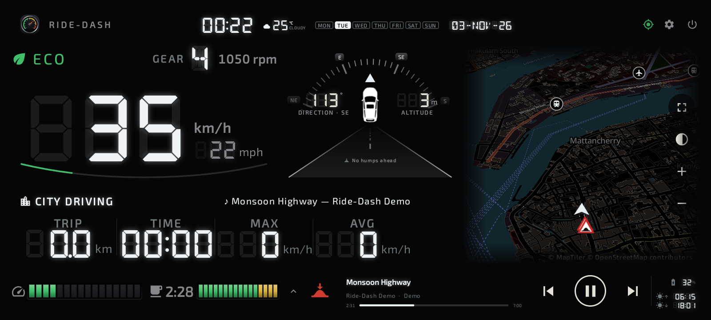
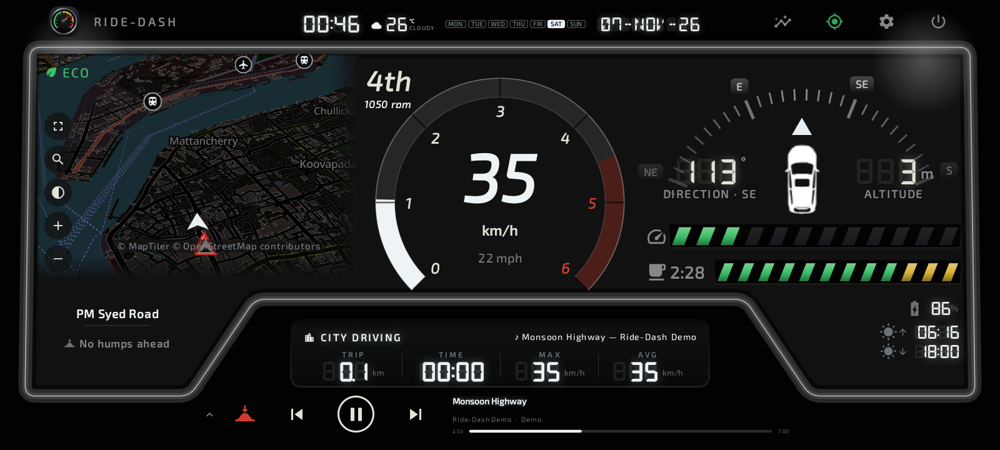
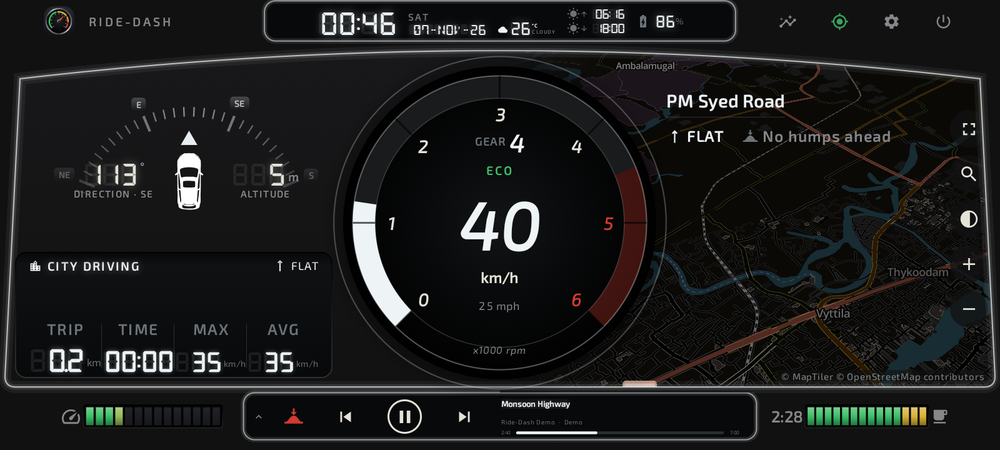
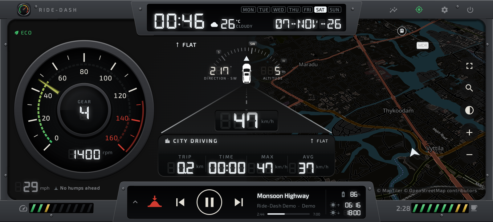
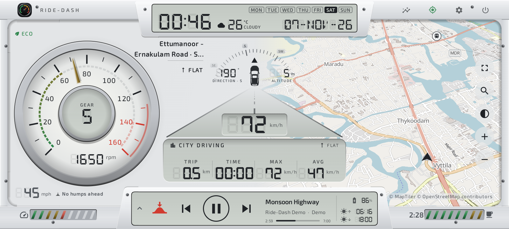
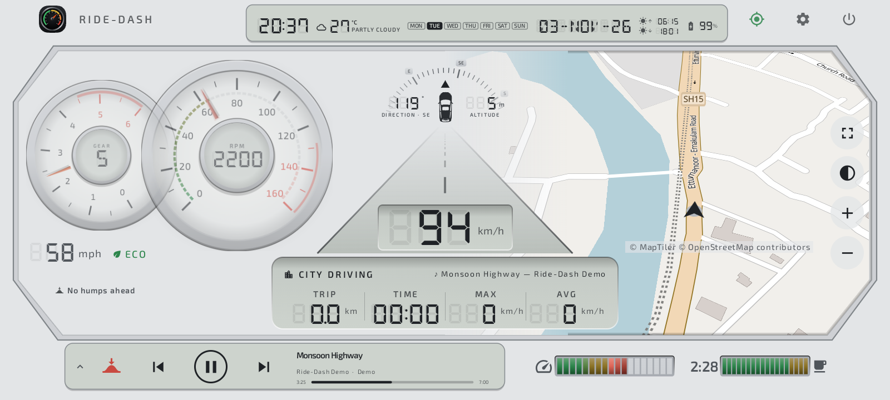

Colour schemes: White (default), Amber, Blue, Red, Green, Titanium and Bronze — or choose your own display colour.
**Background colour** (*Settings › Appearance › Background*): slide from black to mid grey and pick Neutral or a soft
Blue, Green, Red, Brown or Purple tint. The dials and displays stay dark, so everything remains easy to read, and the
map's land takes the same colour, a little darker. The light layouts — **Classic Light**, **Twin Light**, **Duo Light** and **Sport Light**, in their own *Light layouts* section at the top
(the dark ones follow under *Dark layouts*) — start in the White colour scheme the first time you choose one, and have their own light background, light displays and a
light map (the background setting doesn't apply there); every colour scheme works with it in a deeper shade.
You can also upload a background image, your logo and a picture of your car (*Settings › Vehicle*).

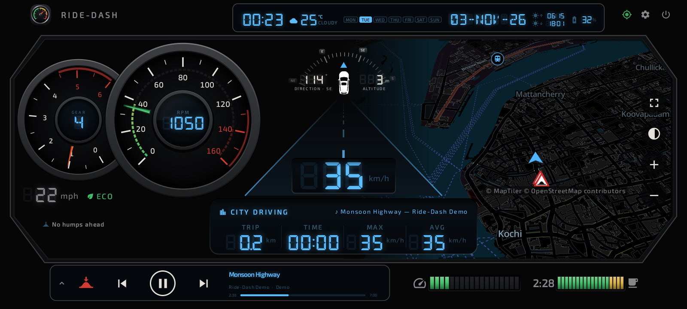

## 5. Speed and speed limits

- The big number is your speed in your colour scheme; the needle, arc and speed bar change colour with speed:
  **green** below 50 km/h, **amber** from 50, **red** from 80, darkest red at 120. Change the limits in
  *Settings › Trip & speed › Speed colours*.
- The other unit (mph or km/h) is shown smaller. The main unit is **Automatic** at first: mph in the US, the UK and
  other countries that sign speeds in mph, km/h everywhere else. Choose km/h or mph yourself in *Settings › Trip & speed
  › Unit*. Every speed and distance follows it: the dashboard, speed-breaker and turn distances (feet below a tenth of a
  mile), the voice, driving insights and the Excel export. The temperature follows your region (°F in the US).

**Road speed limit.** Where OpenStreetMap knows the speed limit of the road you are driving, a round sign shows it on
the map (in Lap beside the driving style). Ride-Dash picks the road you are driving along, so a side road you cross
doesn't take over. Above the limit plus your **tolerance** (+0, +5 or +10 km/h; default +5) the number on the sign
turns red, the drive mode shows **SLOW DOWN** and, with voice alerts, you hear "Slow down. Speed limit sixty kilometres per hour."

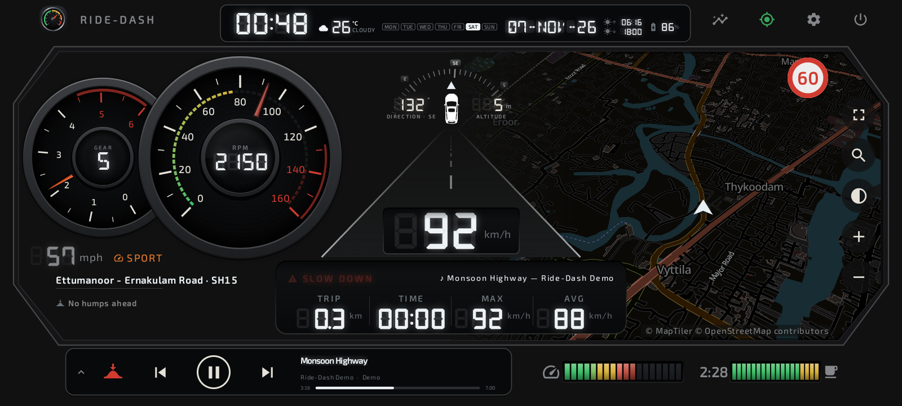

Where no limit is mapped — still many smaller roads in India — the sign is hidden and the old rule applies: SLOW DOWN
at 80 % of the speedometer's scale, the voice at the red speed colour.

The limits are downloaded for about 5 km around you from OpenStreetMap (your position rounded to about 1 km) and kept
on the device for 30 days. *Settings › Trip & speed › Speed limits:* on/off and the tolerance.

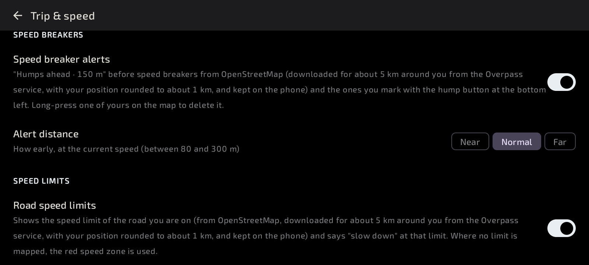

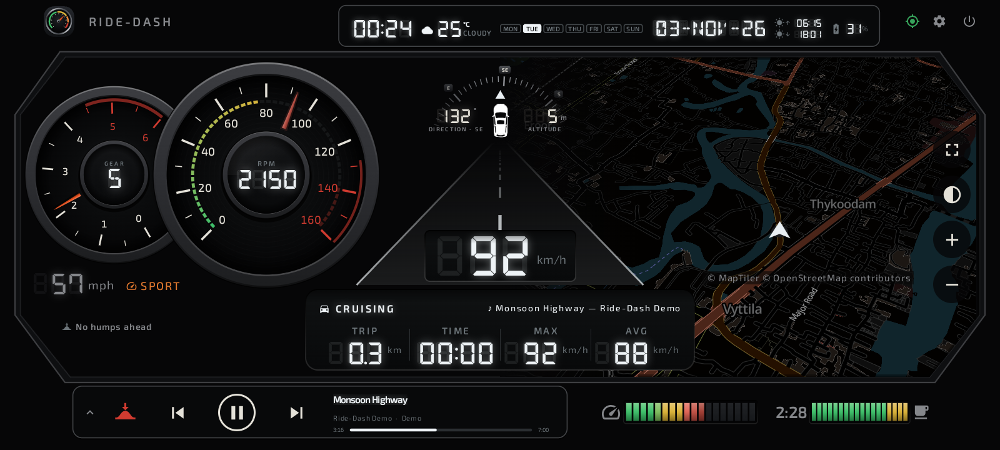

## 6. Driving mode, terrain and road info

**Driving style** (icon and coloured word): **ECO** smooth and steady · **CITY** slow, stop-and-go traffic · **IDLE** standing more
than 30 s in a trip · **SPORT** brisk acceleration, braking or cornering. It comes from GPS alone and changes after a
few seconds, so one brake at a signal doesn't flip it.

**Drive mode** (trip display header): READY, STUCK IN TRAFFIC, CITY DRIVING, CRUISING, HIGHWAY CRUISE, ACCELERATING,
BRAKING, OVERSPEED, PARKED.

**Terrain** (next to it while you drive):

| Word | Meaning |
| --- | --- |
| FLAT | Little height change, mostly straight |
| UPHILL / DOWNHILL | A steady climb or descent, steeper than about 4 % |
| WINDING | Many bends |
| GHAT | Winding and climbing or descending — a hill road |

On climbs and descents the gradient is added: **UPHILL 6 %**, **DOWNHILL 5 %**, **GHAT 8 %**. A new word appears only
after it has held for 15 seconds. Phones with a barometer (most) measure height changes
precisely; head units use GPS height. The trip log shows how much of each trip was in each terrain.

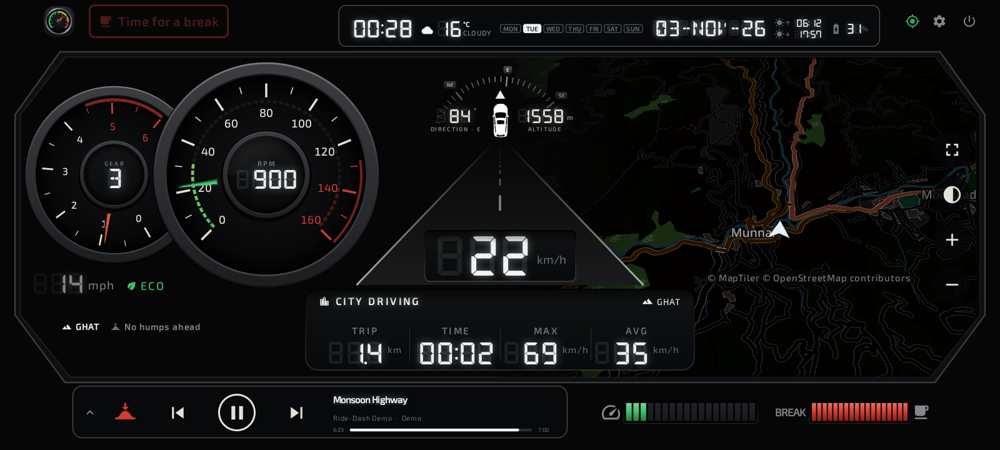

**Road info.** When no route is running, the place where turn-by-turn normally appears shows:

- the **street name** of the road you are on, with its route number ("Ettumanoor - Ernakulam Road · SH15");
- the **terrain** with its gradient;
- the **next speed breaker** on your road ("Hump in 350 m" up to 2 km ahead, or "No humps ahead"), when speed breaker
  alerts are on.

The street name comes from map data loaded in the background (a small download about every 2 km of new road, kept for
30 days), the same on every layout and device, whatever the map's zoom. It keeps the current road at junctions instead
of flickering, and disappears after about 50 m when it can't be confirmed (no internet in a new area) rather than
showing an old road.

Where it shows: Duo and Lap under the map or compass, Classic and Twin beside the compass, Modern, Sport and Cockpit over
the top of the map, Open over the road animation. In Classic and Classic Light the speed-breaker status sits after the
mph reading at the bottom left instead. While a route runs, the **next turn** (arrow, distance, remaining distance and
arrival time) shows together with the street name, in place of terrain and the speed-breaker status. In Classic and Classic
Light the street name stays beside the compass on the left and the next turn appears on its right; in Twin both are in
the card over the map.

## 7. Map

- **Heading-up:** the map turns with the car (north-up in *Settings › Map*).
- **Map style:** *Classic* (dark street map, default) or *Modern* (a crisper vector map, on devices whose graphics allow it).
- **Places:** the places you choose (section 8). The places button on the map shows or hides them all.
- **Full screen:** the expand button fills the screen with the map; Back returns.
- **Next turn** of Ride-Dash's own route (below), or from Google Maps or Waze while they navigate (needs the access in
  step 2), appears on the dashboard.
- Speed breakers show as red-bordered road signs; your parked car as a blue **P**.

**Navigate to a long-pressed place.** Press and hold any spot on the map for about a second:

1. Ride-Dash names the place under your finger — a shop, a landmark, or the road — and asks **"Navigate to MASS
   Road?"** (or "Navigate here?" where there is no name), with how far away it is.
2. **Navigate** shows the route on Ride-Dash's own map (see *Navigating on the Ride-Dash map* below). **Google Maps**
   opens Google Maps with directions by car from where you are; without Google Maps, any installed navigation app is
   offered. **Cancel** or wait 15 seconds to close the question.

**Search a place.** The **🔍 button** on the map opens a search box: type a place or an address (for example *lulu
mall* or *MG Road Kochi*) and press Search. Places near you are listed first, each with how far away it is; tap one for
the same "Navigate to …?" question.

**Navigating on the Ride-Dash map.** After **Navigate** the route appears as a pale blue line on the map with a
red pin at the destination (the part already driven turns grey), and the dashboard's
turn display shows the next turn with its arrow, the distance to it, the distance left and your arrival time. The turns
are spoken ("In 300 metres, turn right onto MG Road") about 500 m and 150 m before the turn (earlier at higher speed)
and at the turn, and "You have arrived at …" at the end. If you take another road, Ride-Dash works out a new route
from where you are. The **✕ button** on the map stops navigating.

Routes and searches come from GraphHopper over the internet; only the start, the destination and the search text are
sent. Ride-Dash has a shared key whose daily limit all users share — for a key of your own (free), see
*Settings › Map › Navigation* and **Get a free key at graphhopper.com**. Paste it into **GraphHopper API key** and tap
**Test key**: it shows whether the key works and how many credits are left today. Your key is stored encrypted on the
device and is not included in backups. When the shared key's daily limit is used up, Ride-Dash says so once and offers
**Open Settings**. Without any key, **Navigate** opens Google Maps as before.

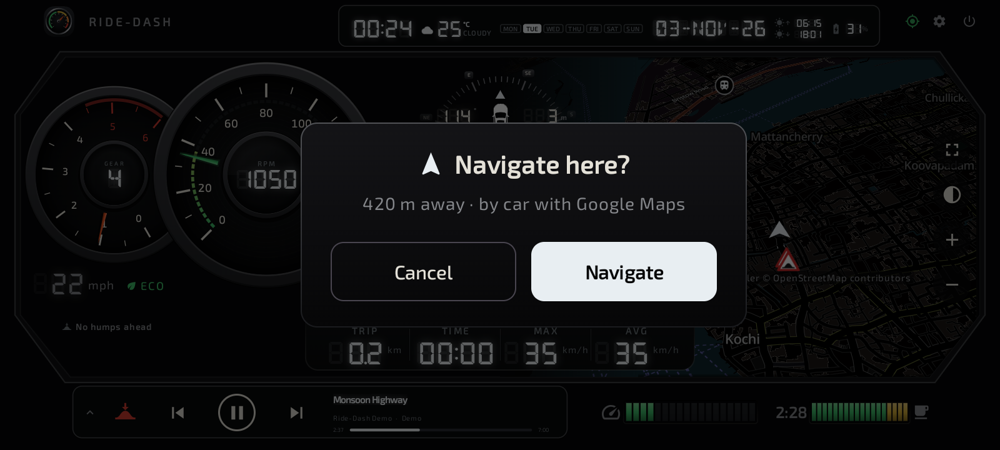

On older head units with the picture-tile map, press and hold a place icon to navigate to it by name; elsewhere the
pressed spot is used. Press and hold one of **your own speed breakers** to delete it instead (section 12).

## 8. Places on the map

*Settings › Map › Map points of interest* (under **Show places**): tick the places you want to see. Each group has
**Select all / Select none**; changes show on the map at once.

| Group | Places (ticked when you install) |
| --- | --- |
| Essentials | **Fuel stations**, **EV charging**, **ATMs**, **Hospitals**, Pharmacies, **Police stations**, Toilets |
| Vehicle | **Car service / repair**, **Tyre / puncture repair**, Car wash, **Parking**, **Toll booths** |
| Food & rest | **Restaurants**, Cafés / tea shops, Fast food, **Hotels / motels / lodges**, **Rest areas** |
| Travel | Railway stations, Bus stations, Airports |
| Sightseeing | **Viewpoints / photo points**, Tourist attractions, Beaches, Waterfalls, Museums, Parks, Places of worship, Cinemas |

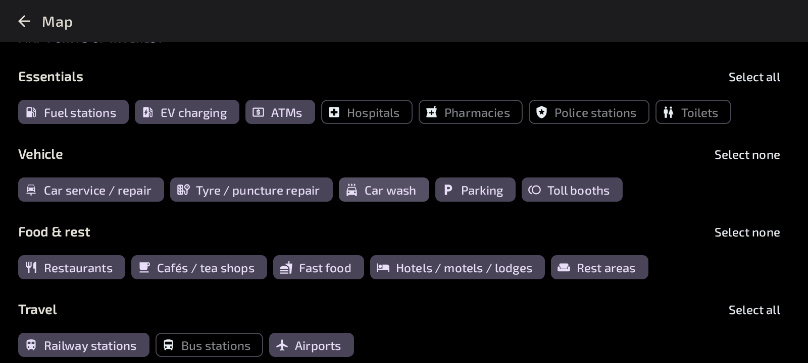

- Every type has its own icon in your display colour; places of worship show a church, mosque, temple or other icon by
  religion.
- To keep the map calm, only a few icons show when zoomed out — essentials first — and food appears once you zoom in to
  street level. Names appear close up.
- **Show places** off hides them all.
- On phones and newer head units the places come with the map itself. On older head units (picture-tile map) they are
  downloaded for about 5 km around you from the map service (MapTiler; OpenStreetMap's Overpass service as a backup)
  and kept for 30 days — the first time in a new area they can take a minute to appear. Airports are not shown there.

## 9. Music

The music panel shows the playing track, a seek bar and large **previous / play-pause / next** buttons on the left
(within reach even with a phone holder in the middle of the screen). It follows whatever app is playing: Spotify,
YouTube Music, the radio app, Bluetooth audio.

- Needs *Music controls & track info* access (step 2). Without it the buttons still work.
- **Head units:** Bluetooth music from your phone shows its title when the unit passes it on (AVRCP); some units keep
  it to their own music app — the buttons still control playback.
- The arrow at the left switches between the music panel and your favourite apps (*Settings › Launcher & apps ›
  Choose dock apps*).

## 10. Trips

- A trip **starts by itself** after about 10 seconds above 7 km/h and 50 m moved — walking or GPS drift never starts
  one.
- It **ends** after you have stood still for 5 minutes (*Settings › Trip & speed › End trip after stopped for*), or
  with the power button (End trip & exit). Short stops at signals don't split a trip.
- **Power cut or ignition off:** the trip is saved every few seconds; next time it is closed at its last saved point
  and marked "auto (power off)" in the export.
- The trip display shows **TRIP** (distance), **TIME** (moving time), **MAX** and **AVG** (moving average).
- Trips shorter than 200 m or 1 minute are not kept.
- *Settings › Trip & speed › Trip log* lists your trips; export them to Excel (section 16).

### Driving insights

The **chart icon** at the top right, left of the GPS status, opens a full-screen dashboard. It opens only while the car
stands ("Available when stopped" otherwise) and closes by itself when you drive off. It works offline, from the trips on
your device.

- **Period:** this week, this month, the last 3 months, this year or a custom range. Totals show the change against the same
  span of the period before.
- **Charts:** distance, average speed, driving time by day and hour, driving mode, terrain, time in your speed zones, hard
  events per 100 km, gear use (estimated — see section 3), break reminders and the score over time. With trips of two or more
  saved vehicles, a row of chips shows one vehicle at a time.
- **Driving score:** 0 to 100, higher is better, for the period and each trip, from acceleration, braking, cornering, speed,
  idling and breaks. A style (Smooth, Balanced, Spirited or Aggressive) says what costs the most points.
- **Recommendations:** a few tips, only those that apply to your driving.
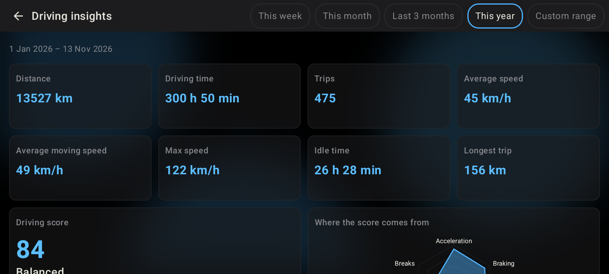

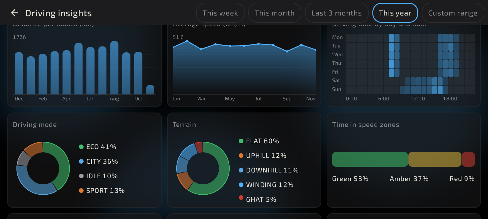

- **Details:** tap any card or chart element to see the matching trips: the Max speed card shows that trip, a month's bar the
  trips of that month, the SPORT slice the trips with the most SPORT time, a heatmap cell the trips in that time slot. Tap a
  column heading to sort, **Clear** to see all trips of the period. Tap a trip for its route on the map, all its numbers, its
  speed over the trip and its driving mode and terrain. Older trips show no route once their route points are removed
  (*Keep route points for* in Settings › Trip & speed). **Back** returns to the chart you came from.

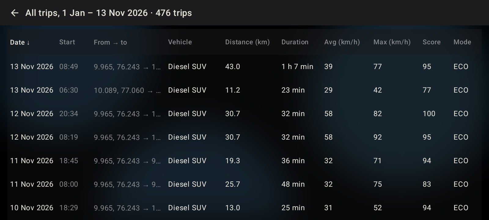

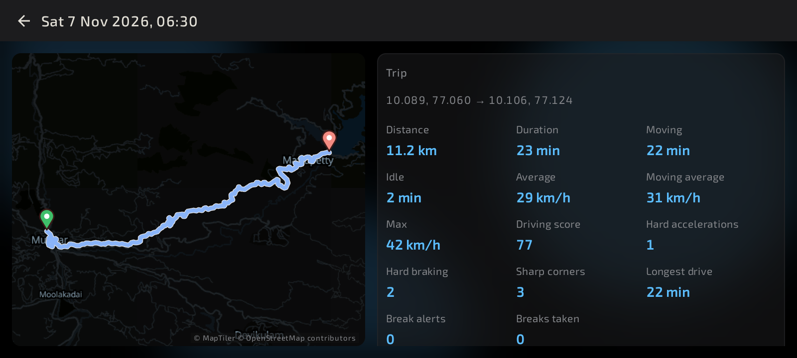

Speed zones, time over the limit and breaks taken are recorded from version 1.9.1 on, so older trips are left out of those.

## 11. Break reminder

The rest bar (driving time, the bar, then the coffee cup) fills from left to right with your continuous driving time (green, amber in the last 30 minutes, red with BREAK when
due). After **2.5 hours** (*Remind after*), **Time for a break** blinks at the top left — never over the speed or the
map — and is spoken. Tap it to snooze for 15 minutes. Short stops pause the timer; standing still for **15 minutes**
(*Break length to reset*) starts it afresh.

## 12. Speed breakers

**Humps ahead · 150 m** appears in red at the top left before a speed breaker on the road ahead, about 9 seconds
early at your speed (80–300 m), and you hear "Speed breaker ahead, in two hundred metres". Only humps on the road you are driving count —
not those on side roads or behind you. A group of humps close together gives one alert; nothing below 15 km/h. The
banner clears once you're past.

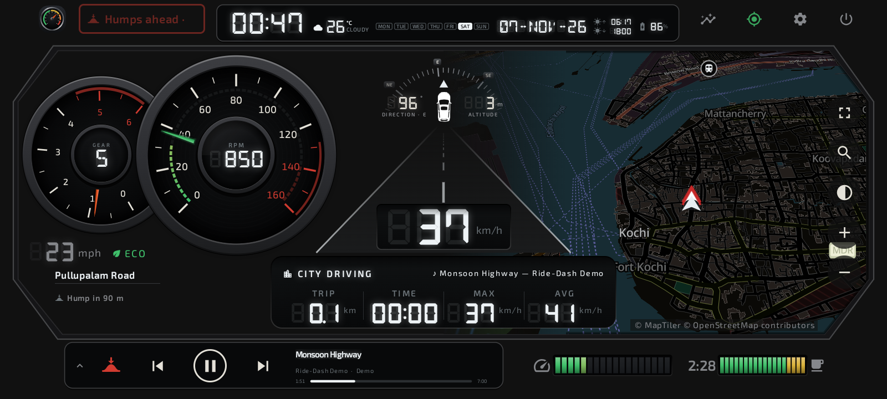

**Where the humps come from:** OpenStreetMap, the free world map anyone can improve. Ride-Dash downloads the speed
breakers within about 5 km of you (sending only a position rounded to about 1 km) and keeps them on the phone, so
roads you have driven before work offline.

**Map your own speed breakers.** Many Indian humps are not in OpenStreetMap yet. As you drive over one, tap the **hump
button** (the red hump sign at the bottom left of the dashboard). It is saved at your position — "Speed breaker marked"
confirms it — shows on the map as a sign, and alerts you like the others from then on. Your marks stay only on this
device.

**Remove one of yours:** press and hold it on the map → **Delete this speed breaker?** → **Delete**. Speed breakers from
OpenStreetMap can't be deleted (they are fixed in OpenStreetMap itself).

**Next speed breaker:** the road info (section 6) shows how far the next one on your road is, up to 2 km ahead.

*Settings › Trip & speed › Speed breakers:* on/off and **Alert distance** Near / Normal / Far.

## 13. Voice alerts

Spoken through the car speakers like navigation (music gets quieter, then comes back):

- "You've been driving for two and a half hours. Time for a break." (your configured time)
- "Slow down. Speed limit sixty kilometres per hour." (miles per hour with miles selected) after 3 seconds above the road's limit plus your tolerance (or the red speed colour where
  no limit is mapped); again only after slowing 5 km/h below it, at most once a minute.
- "Speed breaker ahead, in two hundred metres." (feet or miles with miles selected)
- Turns while navigating on the Ride-Dash map: "In three hundred metres, turn right onto MG Road" (feet / miles with miles selected), "You have arrived at …".

*Settings › Trip & speed › Voice alerts:* on/off, a switch per alert, and **Test**.

**Alert style: Witty.** Prefer a bit of humour? Choose **Witty** under *Alert style*. The important part still comes
first ("Speed limit sixty kilometres per hour. Easy there, racer.", "Speed breaker ahead in two hundred metres. Brace
for the bump."), each alert picks one of several lines, and Ride-Dash also speaks up at a few extra moments: when you
stay too fast (and says thanks when you slow down), after a snoozed break reminder, for several speed breakers in a row,
after a hard stop, when you have been standing for two minutes, on a ghat road, when a trip starts and ends (parking
spot saved), and when GPS still has no fix a minute after start-up. **Test witty voice** plays a random line.

**No voice on a head unit?** Many units have no text-to-speech engine. Settings then says so, and alerts beep instead.
To get voices: install **Speech Services by Google** (Play Store, or its APK on units without Play), open *Android
Settings › Text-to-speech*, choose it as the engine, download the **English (India)** voice, and restart Ride-Dash.

## 14. Where's my car

When a trip ends, the last good GPS position is saved as your parking spot — even in a covered car park where the
signal got weak at the end. Tap the **P** button on the map:

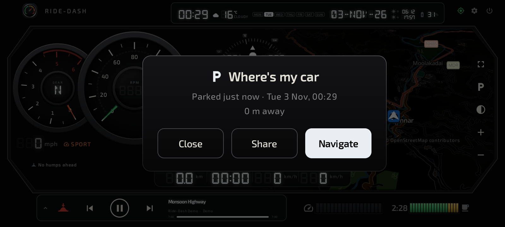

- how long ago you parked and how far away the car is;
- **Navigate:** walking directions in Google Maps;
- **Share:** send the location to someone.

The last 10 spots are in *Settings › Trip & speed › Parking history* and in the Excel export.

## 15. Settings reference

| Page | Setting | Default |
| --- | --- | --- |
| Appearance | Dashboard layout | Classic |
| Appearance | Colour scheme · custom colour | White · none |
| Appearance | Background colour · tint | black · Neutral |
| Appearance | Background image | none |
| Vehicle | Vehicle title | Ride-Dash |
| Vehicle | Brand logo · car image | app icon · none |
| Vehicle | Saved vehicles (name; trips record the one in use) | one, "My vehicle" |
| Vehicle | Preset, fuel, transmission, engine capacity, aspiration (for gear / rpm) | Diesel SUV · 5-speed manual |
| Vehicle | Tyre size, idle, redline; Advanced: gear ratios, final drive, rpm calibration | from the preset |
| Trip & speed | End trip after stopped for | 5 min |
| Trip & speed | Break reminder · remind after · break length · alert sound | on · 2.5 h · 15 min · off |
| Trip & speed | Cruising above | 60 km/h (highway 90) |
| Trip & speed | Unit | km/h |
| Trip & speed | Speed bar full at | 160 km/h |
| Trip & speed | Speed colours: amber / red / darkest red | 50 / 80 / 120 km/h |
| Trip & speed | Speed breaker alerts · alert distance | on · Normal |
| Trip & speed | Road speed limits · tolerance | on · +5 km/h |
| Trip & speed | Voice alerts · break · overspeed · speed breakers | all on |
| Trip & speed | Keep route points for | 90 days |
| Map | Map style | Classic |
| Map | Show places · heading-up · next-turn card | on · on · on |
| Map | Map points of interest | essentials, vehicle, restaurants, hotels, rest areas, viewpoints (section 8) |
| Display | Orientation | Landscape |
| Display | 24-hour clock · driving mode indicator · logo at start-up | on · on · on |
| Display | Full screen | on |
| Display | Keep screen on | While driving / charging |
| Display | Night dimming · level | off · 40 % |
| Display | Weather | on |
| Launcher & apps | Default home app · start on boot | — · off |
| Launcher & apps | Show app dock · dock apps | on · a few common apps |
| Location | Track trip in background | on |
| Trip & speed | Unit | Automatic (from your region) |
| About | App updates (Google Play installs only): Check · weekly check by itself; downloads in the background, then *Restart to update*; asks only while the car stands | on |

## 16. Export, storage and deleting data

- **Export:** *Settings › Trip & speed › Export trips to Excel* — save the file or share it. One row per trip: times,
  distance, speeds, harsh events, driving style and terrain shares, gears, breaks; a Parking sheet; optionally the
  route points.
- **Storage:** trip summaries are kept until you delete them; route points for 90 days (30 days, 1 year or forever),
  at most 50 MB.
- **Backup and restore:** *Settings › Trip & speed › Back up trip data* makes one file (`RideDash_backup_<date>.ridedash`)
  with your trips and, as you choose, route points, parking history, the speed breakers you marked and your settings.
  Save it (to Downloads, a USB stick or Google Drive) or share it. *Restore from a backup* shows what the file holds and
  then **merges** (adds the trips that aren't on this device yet; nothing is doubled) or **replaces** the finished trips
  here. Settings — including your saved vehicles — are restored only when you tick *Also restore settings*; the vehicles
  here are then replaced by the ones in the backup. Use it to move your trips between the phone and
  the head unit, or to keep them safe before reinstalling. A damaged file, or one from a newer Ride-Dash, changes
  nothing. The Excel export stays for looking at your trips; it can't be imported back.
- **Delete:** *Delete all trip data* removes trips, routes and parking spots. Uninstalling removes everything.
- Nothing is uploaded: see the [privacy policy](privacy-policy.html).

## 17. Troubleshooting

| Problem | Try this |
| --- | --- |
| Speed stays `--`, "SEARCHING GPS" | Go outdoors; on head units check the GPS antenna can see the sky; wait a few minutes the first time. *Settings › Location* — is location allowed? |
| Gauges slow to react after parking | Fixed in 1.3.0 — update. |
| No song title | Allow *Music controls & track info* (Settings › Launcher & apps). Bluetooth music on some head units never sends titles; the buttons still work. |
| No voice | *Settings › Trip & speed › Voice alerts › Test*. If it says there's no engine, install one (section 13). Check the media volume. |
| No speed-limit sign | Most smaller roads have no limit in OpenStreetMap yet; the sign shows only where one is mapped. The first download in an area needs internet. Is *Road speed limits* on? |
| No street name | The first time in an area it needs internet (phone hotspot on head units). Unnamed roads show none. |
| A place type missing on the map | Tick it in *Settings › Map › Map points of interest*; zoom in — some show only close up. |
| No speed breaker alerts | Is the setting on? Are you above 15 km/h? The hump may not be in OpenStreetMap — mark it with the hump button. The first download needs internet. |
| Map is blank | The map needs internet the first time in an area (phone hotspot on head units). |
| Trip split in two | Raise *End trip after stopped for*. |
| App won't install on a head unit | Free 100 MB, check Android 8+, copy the APK again; see section 1. |
| The app closed by itself | *Settings › About › Last crash report › Share* and send it to ridedash.app@gmail.com. |

**Feedback and ideas:** *Settings › About › Send feedback / Request a feature / Report a problem*, or write to
ridedash.app@gmail.com.

[Back to the home page](index.html)
