# Ride-Dash user manual

_Version 1.3.0 · October 2026_

Ride-Dash turns the phone in your holder — or your car's Android head unit — into a calm, complete car dashboard:
live speed, gear, heading and altitude, trip statistics, terrain, speed breaker and break alerts spoken aloud, music,
the map and "Where's my car". Everything works on the device; no account needed.

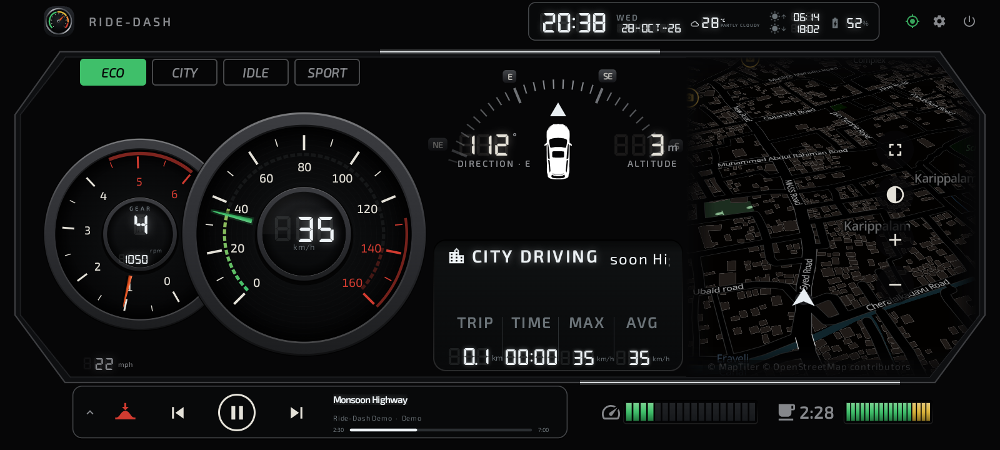

**Contents:** [What's new](#whats-new-in-130) · [1 Installing](#1-installing) · [2 First start](#2-first-start) ·
[3 The dashboard](#3-the-dashboard) · [4 Layouts and colours](#4-layouts-and-colours) · [5 Speed](#5-speed) ·
[6 Driving mode and terrain](#6-driving-mode-and-terrain) · [7 Map](#7-map) · [8 Music](#8-music) ·
[9 Trips](#9-trips) · [10 Breaks](#10-break-reminder) · [11 Speed breakers](#11-speed-breakers) ·
[12 Voice alerts](#12-voice-alerts) · [13 Where's my car](#13-wheres-my-car) · [14 Settings](#14-settings-reference) ·
[15 Export and storage](#15-export-storage-and-deleting-data) · [16 Troubleshooting](#16-troubleshooting)

## What's new in 1.3.0

- **Speed breaker alerts:** "Humps ahead · 150 m" before speed breakers on the road ahead, from OpenStreetMap and your
  own marks. One tap on the hump button marks a new one.
- **Voice alerts:** break reminder, "Slow down" and "Speed breaker ahead" spoken through the car speakers; music gets
  quieter meanwhile.
- **Terrain:** FLAT, UPHILL, DOWNHILL, WINDING or GHAT while you drive, and the share of each in the trip log.
- **Where's my car:** your parking spot is saved when a trip ends; walking directions back to it.
- **Waiting for GPS:** the dashboard shows `--` and the satellites found instead of looking frozen; the map starts at
  your last position; GPS starts sooner on head units.
- **Gauges wake up at once** when you drive off after a long stop.
- **Demo mode** for trying everything at your desk (Settings › About, tap the version 7 times).

## 1. Installing

**Phone (Google Play):** search for **Ride-Dash** in Google Play and tap **Install**. Android 8 or newer.

**Car head unit (APK file):** most Android head units can't reach Google Play, so Ride-Dash is installed from a file.

1. Copy `Ride-Dash-<version>-release.apk` to a USB stick (FAT32 or exFAT) and plug it into the unit.
2. Allow installing apps from the file manager: *Settings › Security › Unknown sources* on older units, or
   *Settings › Apps › Special access › Install unknown apps › (file manager) › Allow*. Some units hide this behind a
   factory code — see the unit's manual.
3. Open the file manager, tap the APK, choose **Install**.
4. "App not installed": free about 100 MB of storage and try again; check the unit runs Android 8 or newer
   (*Settings › About*).

Updates install the same way over the old version; your settings and trips are kept.

## 2. First start

1. **Location** — tap **Continue** and allow location "While using the app". Speed, trips, the compass and the map all
   come from GPS.
2. **Notifications** — allow them: the trip keeps counting while other apps are in front.
3. **Music and navigation info (optional)** — *Settings › Launcher & apps › Music controls & track info › Allow* lets
   Ride-Dash show the song and the next turn from Google Maps or Waze.
4. **Head units:** *Settings › Launcher & apps › Set as default home app* (Ride-Dash opens with the car), and
   *Start on boot*.

**Waiting for the first GPS fix.** Until GPS knows where you are, the speed shows `--` and the trip display reads
`SEARCHING GPS · 3/11 SATS` (satellites used / in view). A phone usually needs seconds; a head unit can need a few
minutes the first time, especially indoors.

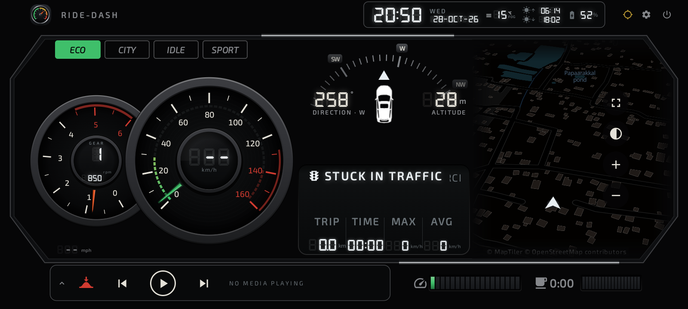

Head-unit tips: the GPS antenna (a small square puck on a cable) must see the sky — put it under the windscreen or the
dashboard top, not inside the glovebox or under metal. Wait outdoors with the engine running the first time. *Settings
› About* shows how long the first fix took.

## 3. The dashboard

| Where | What |
| --- | --- |
| Top left | Your logo and vehicle name; alerts appear here (break, speed breakers) |
| Top centre | Time, weather, sunrise / sunset, battery, weekday and date |
| Top right | GPS status, settings, power (end trip and exit) |
| Mode chips | ECO · CITY · IDLE · SPORT — how you are driving |
| Speedometer | Speed with colour zones; gear and rpm (estimated); the other unit below |
| Compass | Heading, direction, altitude above sea level |
| Trip display | Drive mode, terrain, distance, moving time, top and average speed |
| Map | Where you are, heading up; speed breakers, sights, your parked car |
| Bottom left | **Hump button** (mark a speed breaker), music controls and track |
| Bottom right | Speed bar and break (rest) bar |

The arrangement differs per layout, but every layout has the same pieces.

## 4. Layouts and colours

*Settings › Appearance.* Pick a **layout** (the arrangement) and a **colour scheme** (the colours) separately.

| Layout | The look |
| --- | --- |
| Open | Frameless: a huge digital speed and big trip readings |
| Lap | Racing visor, speed inside the rpm arc |
| Duo | GT cluster with a wide map |
| Cockpit | One ring gauge in the middle |
| Classic | Analogue speedometer, compass and road |
| Sport | Big centred speedometer |
| Modern | Fully digital cluster |
| Twin | Speedometer and rev counter with a map window |

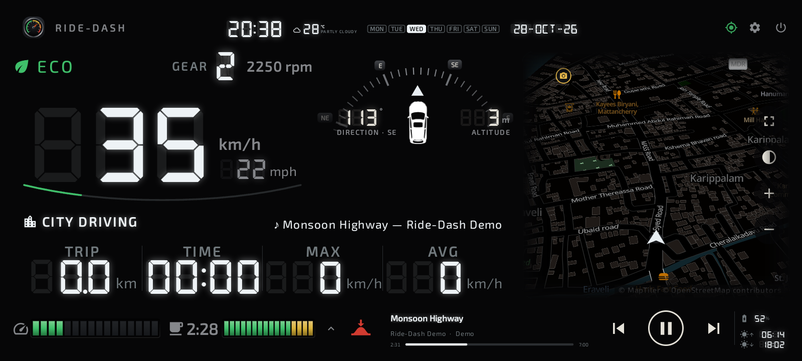
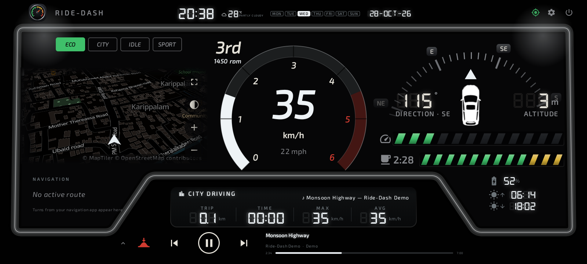
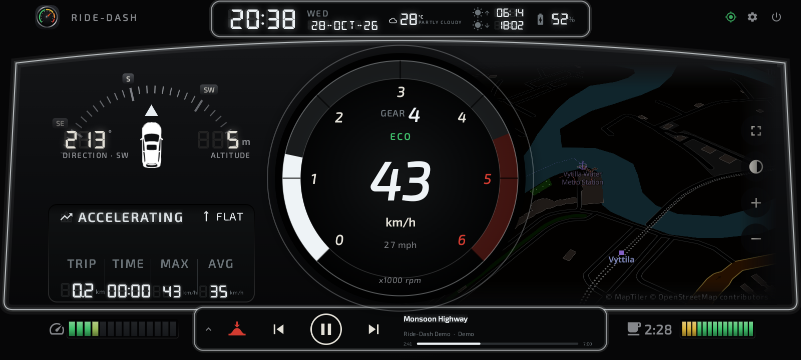
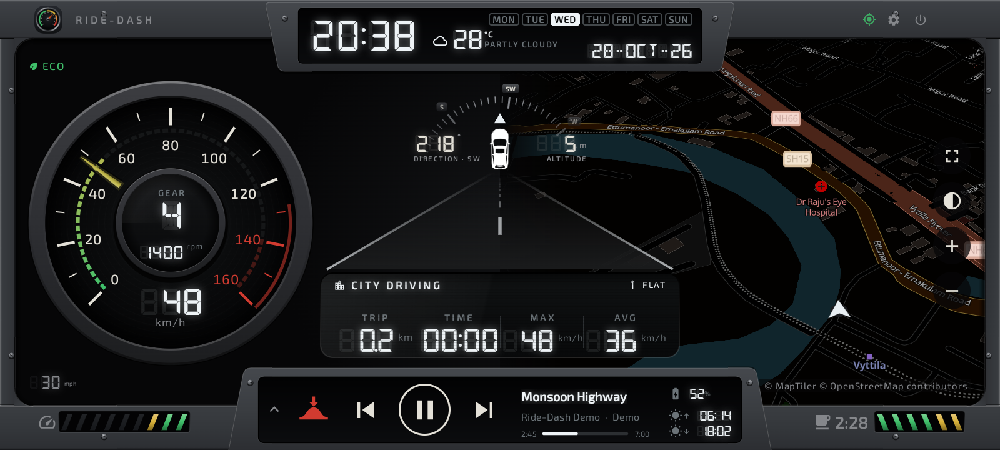

Colour schemes: White (default), Amber, Blue, Red, Green, Titanium and Bronze — or choose your own display colour.
You can also upload a background image, your logo and a picture of your car (*Settings › Vehicle*).

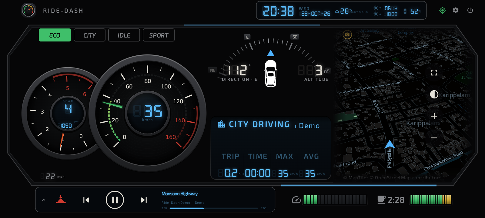

## 5. Speed

- The big number is your speed in your colour scheme; the needle, arc and speed bar change colour with speed:
  **green** below 50 km/h, **amber** from 50, **red** from 80 (the highway limit), darkest red at 120. Change the
  limits in *Settings › Trip & speed › Speed colours*.
- The other unit (mph or km/h) is shown small. Switch the main unit in *Settings › Trip & speed › Unit*.
- Above the red limit the drive mode shows **OVERSPEED** and blinks; with voice alerts you hear "Slow down".

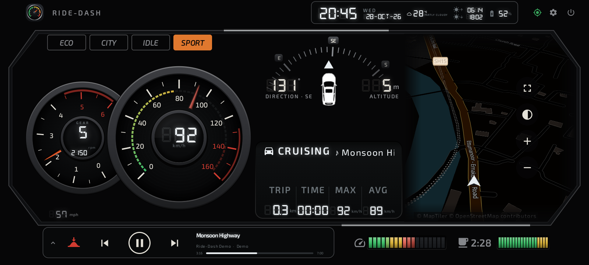

## 6. Driving mode and terrain

**Driving mode** (the chips): **ECO** smooth and steady · **CITY** slow, stop-and-go traffic · **IDLE** standing more
than 30 s in a trip · **SPORT** brisk acceleration, braking or cornering. It comes from GPS alone and changes after a
few seconds, so one brake at a signal doesn't flip it.

**Drive mode** (trip display header): READY, STUCK IN TRAFFIC, CITY DRIVING, CRUISING, HIGHWAY CRUISE, ACCELERATING,
BRAKING, OVERSPEED, PARKED.

**Terrain** (next to it while you drive):

| Word | Meaning |
| --- | --- |
| FLAT | Little height change, mostly straight |
| UPHILL / DOWNHILL | A steady climb or descent, steeper than about 4 % |
| WINDING | Many bends |
| GHAT | Winding and climbing or descending — a hill road |

A new word appears only after it has held for 15 seconds. Phones with a barometer (most) measure height changes
precisely; head units use GPS height. The trip log shows how much of each trip was in each terrain.

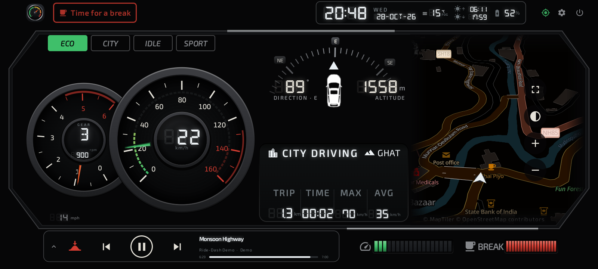

## 7. Map

- **Heading-up:** the map turns with the car (north-up in *Settings › Map*).
- **Map style:** *Classic* (dark street map, default) or *Modern* (a crisper vector map, on devices whose graphics allow it).
- **Places and sights:** viewpoints, monuments, waterfalls and other sights get a camera marker. The places button
  on the map shows or hides points of interest.
- **Navigate anywhere:** press and hold a place on the map → "Navigate to …?" → **Navigate** opens Google Maps
  directions by car.
- **Full screen:** the expand button fills the screen with the map; Back returns.
- **Next turn** from Google Maps or Waze appears on the dashboard while they navigate (needs the access in step 2).
- Speed breakers show as red-bordered road signs; your parked car as a blue **P**.

## 8. Music

The music panel shows the playing track, a seek bar and large **previous / play-pause / next** buttons on the left
(within reach even with a phone holder in the middle of the screen). It follows whatever app is playing: Spotify,
YouTube Music, the radio app, Bluetooth audio.

- Needs *Music controls & track info* access (step 2). Without it the buttons still work.
- **Head units:** Bluetooth music from your phone shows its title when the unit passes it on (AVRCP); some units keep
  it to their own music app — the buttons still control playback.
- The arrow at the left switches between the music panel and your favourite apps (*Settings › Launcher & apps ›
  Choose dock apps*).

## 9. Trips

- A trip **starts by itself** after about 10 seconds above 7 km/h and 50 m moved — walking or GPS drift never starts
  one.
- It **ends** after you have stood still for 5 minutes (*Settings › Trip & speed › End trip after stopped for*), or
  with the power button (End trip & exit). Short stops at signals don't split a trip.
- **Power cut or ignition off:** the trip is saved every few seconds; next time it is closed at its last saved point
  and marked "auto (power off)" in the export.
- The trip display shows **TRIP** (distance), **TIME** (moving time), **MAX** and **AVG** (moving average).
- Trips shorter than 200 m or 1 minute are not kept.
- *Settings › Trip & speed › Trip log* lists your trips; export them to Excel (section 15).

## 10. Break reminder

The coffee-cup bar fills with your continuous driving time (green, amber in the last 30 minutes, red with BREAK when
due). After **2.5 hours** (*Remind after*), **Time for a break** blinks at the top left — never over the speed or the
map — and is spoken. Tap it to snooze for 15 minutes. Short stops pause the timer; standing still for **15 minutes**
(*Break length to reset*) starts it afresh.

## 11. Speed breakers

**Humps ahead · 150 m** appears in red at the top left before a speed breaker on the road ahead, about 9 seconds
early at your speed (80–300 m), and you hear "Speed breaker ahead". Only humps on the road you are driving count —
not those on side roads or behind you. A group of humps close together gives one alert; nothing below 15 km/h. The
banner clears once you're past.

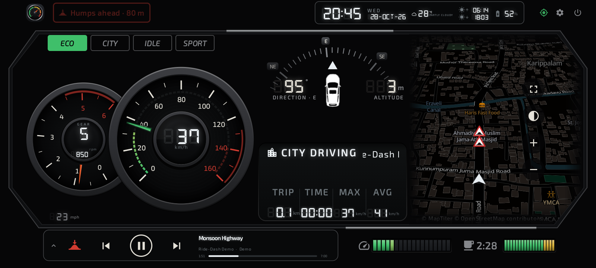

**Where the humps come from:** OpenStreetMap, the free world map anyone can improve. Ride-Dash downloads the speed
breakers within about 5 km of you (sending only a position rounded to about 1 km) and keeps them on the phone, so
roads you have driven before work offline.

**Mark hump here:** many Indian humps are not in OpenStreetMap yet. Tap the **hump button** (bottom left) as you pass
one — it is saved at your position and alerts like the others. To delete one of yours, press and hold it on the map →
**Delete**.

*Settings › Trip & speed › Speed breakers:* on/off and **Alert distance** Near / Normal / Far.

## 12. Voice alerts

Spoken through the car speakers like navigation (music gets quieter, then comes back):

- "You've been driving for two and a half hours. Time for a break." (your configured time)
- "Slow down. Speed limit 80." after 3 seconds above the red limit; again only after slowing 5 km/h below it, at most
  once a minute.
- "Speed breaker ahead."

*Settings › Trip & speed › Voice alerts:* on/off, a switch per alert, and **Test**.

**No voice on a head unit?** Many units have no text-to-speech engine. Settings then says so, and alerts beep instead.
To get voices: install **Speech Services by Google** (Play Store, or its APK on units without Play), open *Android
Settings › Text-to-speech*, choose it as the engine, download the **English (India)** voice, and restart Ride-Dash.

## 13. Where's my car

When a trip ends, the last good GPS position is saved as your parking spot — even in a covered car park where the
signal got weak at the end. Tap the **P** button on the map:

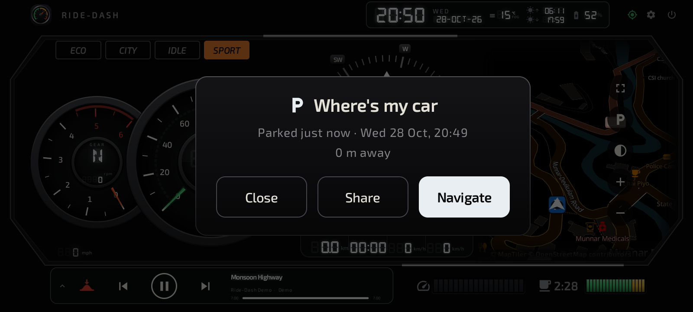

- how long ago you parked and how far away the car is;
- **Navigate:** walking directions in Google Maps;
- **Share:** send the location to someone.

The last 10 spots are in *Settings › Trip & speed › Parking history* and in the Excel export.

## 14. Settings reference

| Page | Setting | Default |
| --- | --- | --- |
| Appearance | Dashboard layout | Classic |
| Appearance | Colour scheme · custom colour | White · none |
| Appearance | Background image | none |
| Vehicle | Vehicle title | Ride-Dash |
| Vehicle | Brand logo · car image | app icon · none |
| Vehicle | Engine & gearbox preset (for gear / rpm) | Diesel SUV · 5-speed manual |
| Vehicle | Tyre size, gear ratios, final drive, idle, redline, automatic | from the preset |
| Trip & speed | End trip after stopped for | 5 min |
| Trip & speed | Break reminder · remind after · break length · alert sound | on · 2.5 h · 15 min · off |
| Trip & speed | Cruising above | 60 km/h (highway 90) |
| Trip & speed | Unit | km/h |
| Trip & speed | Speed bar full at | 160 km/h |
| Trip & speed | Speed colours: amber / red / darkest red | 50 / 80 / 120 km/h |
| Trip & speed | Speed breaker alerts · alert distance | on · Normal |
| Trip & speed | Voice alerts · break · overspeed · speed breakers | all on |
| Trip & speed | Keep route points for | 90 days |
| Map | Map style | Classic |
| Map | Show places · heading-up · next-turn card | on · on · on |
| Display | Orientation | Landscape |
| Display | 24-hour clock · driving mode indicator · logo at start-up | on · on · on |
| Display | Full screen | on |
| Display | Keep screen on | While driving / charging |
| Display | Night dimming · level | off · 40 % |
| Display | Weather | on |
| Launcher & apps | Default home app · start on boot | — · off |
| Launcher & apps | Show app dock · dock apps | on · a few common apps |
| Location | Track trip in background | on |

## 15. Export, storage and deleting data

- **Export:** *Settings › Trip & speed › Export trips to Excel* — save the file or share it. One row per trip: times,
  distance, speeds, harsh events, driving style and terrain shares, gears, breaks; a Parking sheet; optionally the
  route points.
- **Storage:** trip summaries are kept until you delete them; route points for 90 days (30 days, 1 year or forever),
  at most 50 MB.
- **Backup:** export to Excel from time to time — your trips exist only on this device.
- **Delete:** *Delete all trip data* removes trips, routes and parking spots. Uninstalling removes everything.
- Nothing is uploaded: see the [privacy policy](privacy-policy.html).

## 16. Troubleshooting

| Problem | Try this |
| --- | --- |
| Speed stays `--`, "SEARCHING GPS" | Go outdoors; on head units check the GPS antenna can see the sky; wait a few minutes the first time. *Settings › Location* — is location allowed? |
| Gauges slow to react after parking | Fixed in 1.3.0 — update. |
| No song title | Allow *Music controls & track info* (Settings › Launcher & apps). Bluetooth music on some head units never sends titles; the buttons still work. |
| No voice | *Settings › Trip & speed › Voice alerts › Test*. If it says there's no engine, install one (section 12). Check the media volume. |
| No speed breaker alerts | Is the setting on? Are you above 15 km/h? The hump may not be in OpenStreetMap — mark it with the hump button. The first download needs internet. |
| Map is blank | The map needs internet the first time in an area (phone hotspot on head units). |
| Trip split in two | Raise *End trip after stopped for*. |
| App won't install on a head unit | Free 100 MB, check Android 8+, copy the APK again; see section 1. |
| The app closed by itself | *Settings › About › Last crash report › Share* and send it to ridedash.app@gmail.com. |

**Feedback and ideas:** *Settings › About › Send feedback / Request a feature / Report a problem*, or write to
ridedash.app@gmail.com.

[Back to the home page](index.html)
