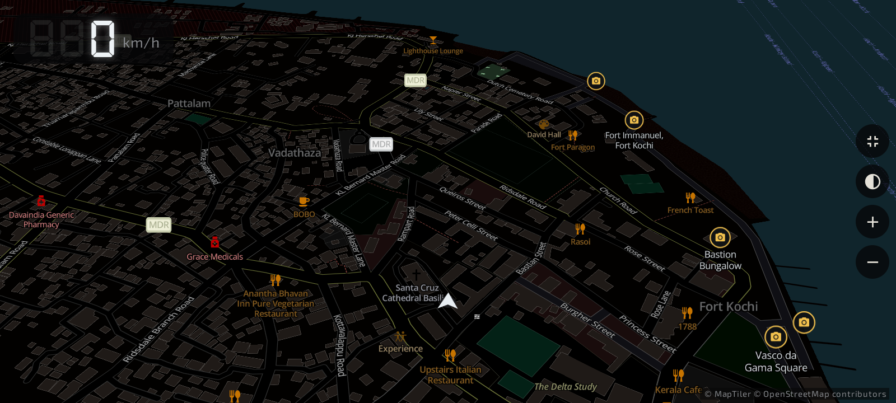
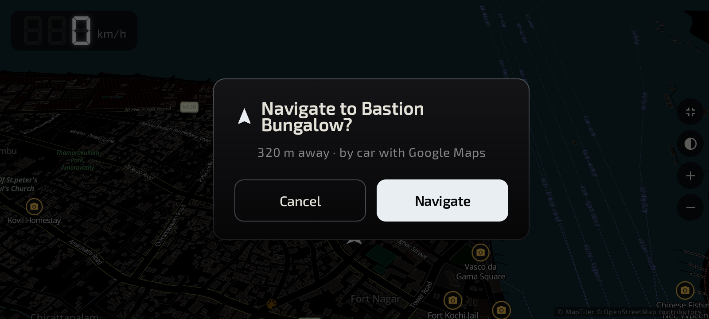
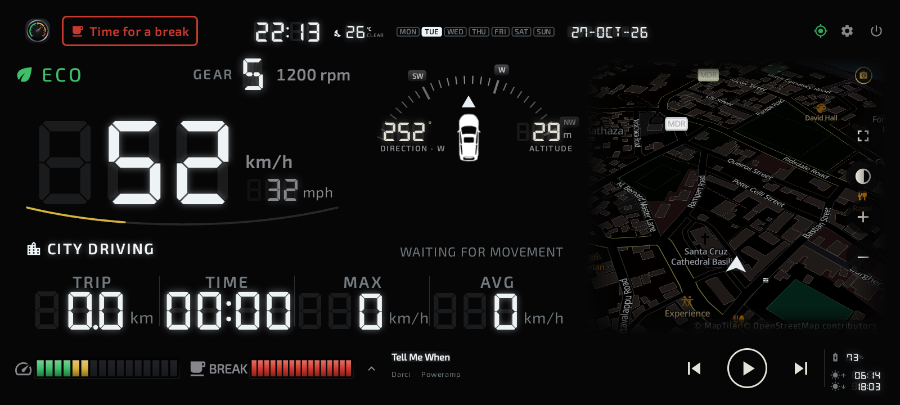
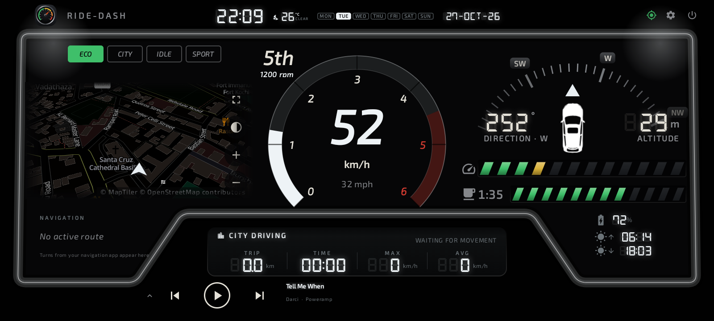
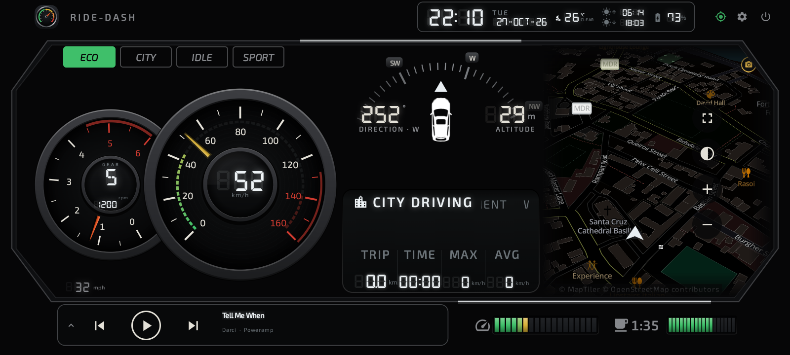
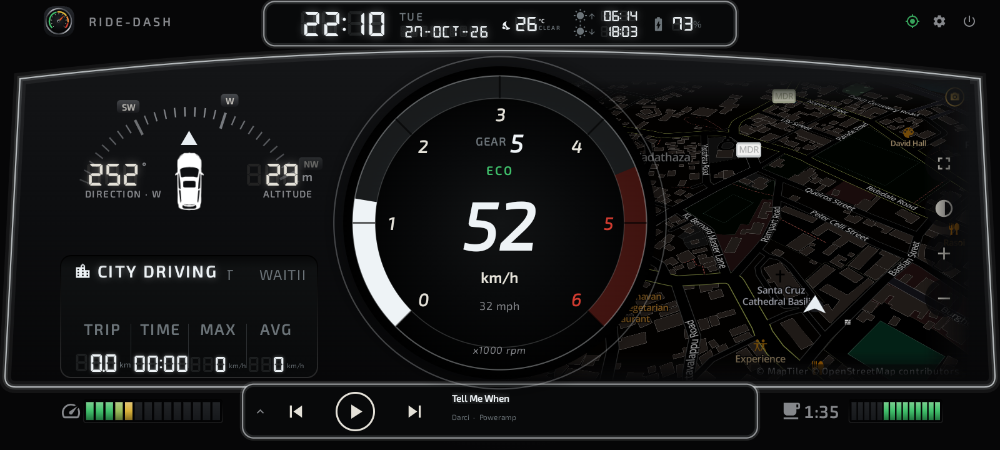
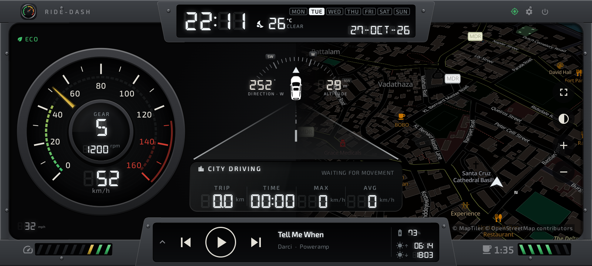
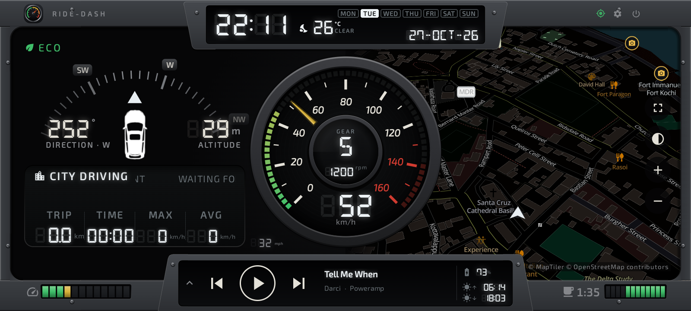
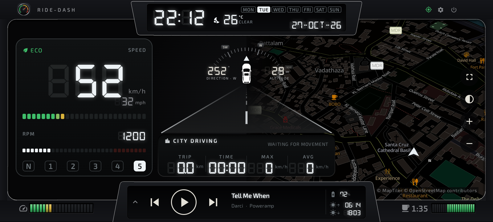
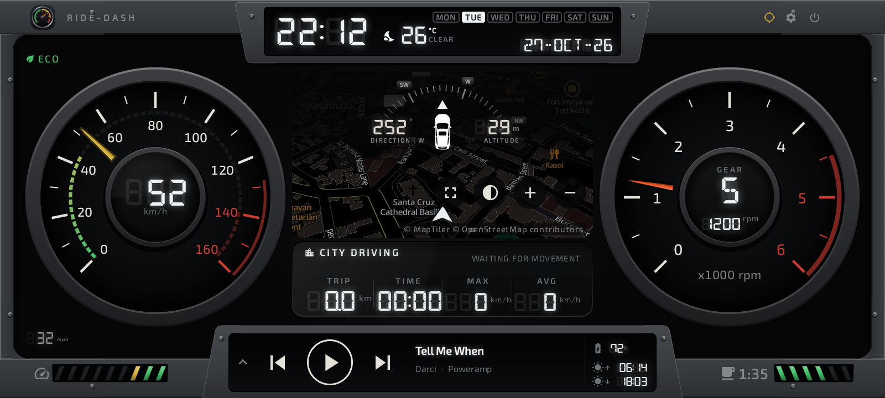

# Ride-Dash — your ride companion

Ride-Dash turns the phone in your holder into a full car dashboard: live speed, trip statistics, nearby sights,
one-touch navigation and a break reminder — for the driver and everyone riding along.

## At a glance

Put your phone in a dashboard holder, open Ride-Dash, and drive. Everything you and your passengers want to know
about the ride sits on one screen, readable in a glance.

- **See the ride:** speed, gear, rpm, heading, altitude and driving style, live.
- **Know the trip:** distance, moving time, top and average speed, recorded automatically.
- **Find places:** viewpoints and sights marked on the map; long-press any place to navigate there.
- **Stay fresh:** a gentle reminder when it's time for a break.
- **Make it yours:** 8 dashboard layouts and 7 colour schemes.

Ride-Dash works on any Android phone (Android 8 or newer) and also runs as a home screen on Android car head units.

## Who rides with it

| Who | What they get |
| --- | --- |
| Driver | Big, calm speed readout with colour-coded needle and speed bar; next turn from Google Maps or Waze; a break reminder after long stretches |
| Co-driver / navigator | Live trip statistics, heading and altitude; sights and places on the map; one long-press to send the next destination to Google Maps |
| Passengers | Music title and controls, distance covered and time on the road, how far the next stop is |
| Trip planners | Every trip saved with distance, times, driving style and breaks, exported to Excel |

## Get going in 2 minutes

1. Install Ride-Dash from Google Play.
2. Allow **location** when asked: speed, trips and the map all come from GPS.
3. Optional: allow **notification access** so Ride-Dash can show the playing song and the next turn from Google Maps
   or Waze.
4. Mount the phone in a landscape holder where you can see it without looking away from the road.
5. Start driving. A trip begins by itself after about 10 seconds above 7 km/h and ends after a few minutes standing
   still.

## Explore and navigate

- **Sights on the map.** Viewpoints, attractions, monuments, memorials, forts, ruins, waterfalls and artworks get a
  camera marker with their name, even when zoomed out.
- **Long-press to navigate.** Press and hold a place's name or icon. Ride-Dash asks *"Navigate to Bastion Bungalow?
  320 m away"*; tap **Navigate** and Google Maps starts turn-by-turn directions by car. The prompt closes by itself
  after 15 seconds, so a stray touch never takes you off the dashboard.
- **Full-screen map.** Tap the expand button on the map to fill the screen; your speed stays visible in the corner.
- **Next turn on the dashboard** while Google Maps or Waze navigates.
- **Heading-up map** that turns with the car, or north-up if you prefer.

## Trip stats that tell the story

| Reading | What it shows |
| --- | --- |
| TRIP | Distance of the current trip |
| TIME | Time actually moving (stops don't count) |
| MAX / AVG | Top speed and average moving speed |
| Drive mode | READY, CITY, CRUISING, HIGHWAY, TRAFFIC, PARKED, and OVERSPEED, which blinks |
| Driving style | ECO, CITY, IDLE or SPORT, from how smoothly you accelerate and brake |
| Gear and rpm | Estimated from speed and your vehicle's gearbox |
| Compass | Heading in degrees and direction, plus altitude above sea level |

Every trip is kept with its start, end, distance, times, top speed, driving style, harsh braking and the longest
drive without a break. Export it all to Excel from Settings.

## Take a break

After 2.5 hours of continuous driving, Ride-Dash reminds you to rest. A coffee-cup bar fills with your driving time
(green, amber in the last 30 minutes, red with BREAK when due), and a *Time for a break* banner blinks at the top —
never over the speed or the map. Tap it to snooze for 15 minutes. Short stops only pause the timer; 15 minutes
standing still starts it afresh. Choose the times in Settings › Trip & speed.

## Speed at a glance

- Colour-coded needle and speed bar: green below 50 km/h, amber from 50, red from 80, deep red from 120 — your own
  limits in Settings.
- Both units: km/h large with mph beside it, or the other way round.

## Music and apps

Big previous / play / next buttons, the track title and a seek bar for whatever music app is playing; tap the arrow
for your favourite apps.

## Make it yours

| Layout | The look |
| --- | --- |
| Open | Frameless, a huge digital speed, big trip readings |
| Lap | Racing visor, speed in the rpm arc |
| Duo | GT cluster with a wide map |
| Cockpit | One ring gauge in the middle |
| Classic | Analogue speedometer, compass and road |
| Sport | Big centred speedometer |
| Modern | Fully digital cluster |
| Twin | Speedometer and rev counter with a map window |

Colour schemes: White, Amber, Blue, Red, Green, Titanium Ice and Bronze, or your own colour. Upload your own logo,
vehicle name, car picture and background.

## Built for the road

- Easy on the battery: the dashboard rests when you're parked and wakes up when you move.
- Keep the screen on always, while driving or charging, or follow the phone's timeout; optional night dimming.
- Weather, sunrise and sunset next to the clock.
- Free OpenStreetMap maps in a dark style that matches your colours. No account needed.
- Private by design: see the [privacy policy](privacy-policy.html).

[Back to the home page](index.html)
